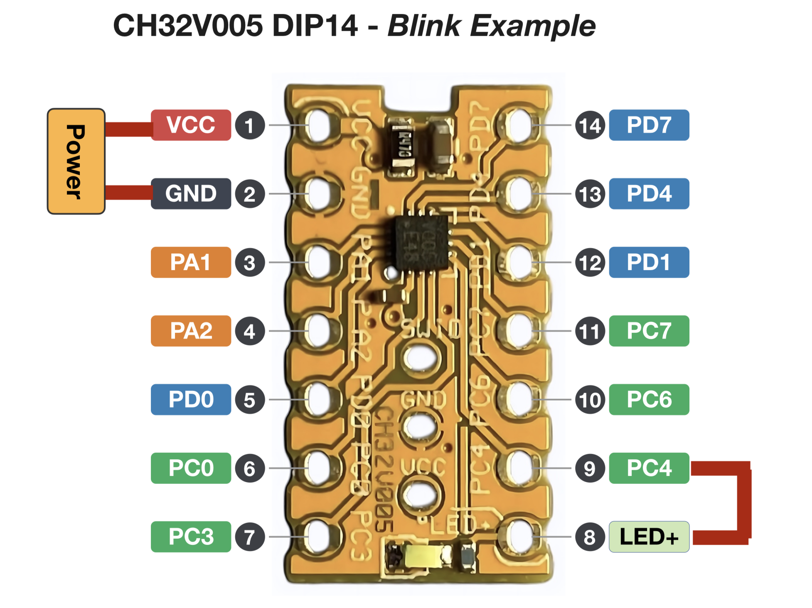

CH32V005 Blink Example

A minimal blink example for the WCH CH32V005 microcontroller using PlatformIO and ch32fun.

Overview

This project demonstrates basic GPIO control by periodically toggling PC7.

* MCU: WCH CH32V005
* Framework: ch32fun
* Build system: PlatformIO
* GPIO: PC7
* Blink interval: 333 ms

Hardware

Build

1. Install Visual Studio Code.
2. Install the PlatformIO IDE extension.
3. Install the ch32fun extension.
4. Open this project folder in Visual Studio Code.
5. Build the project using PlatformIO.

Source Code

* src/main.c — Main application
* src/funconfig.h — ch32fun configuration
* platformio.ini — PlatformIO project configuration
